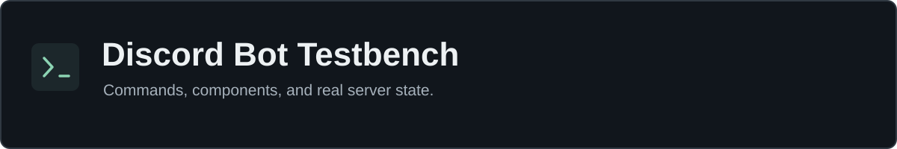

[](https://github.com/oliolaDEV/discord-bot-testbench/actions/workflows/ci.yml)
[](LICENSE)
[](https://github.com/oliolaDEV/discord-bot-testbench/stargazers)
[](docs/ADAPTERS.md)

Run a development bot's commands and component handlers from your coding agent, then check the resulting messages, channels and permissions on Discord.

Native adapters connect discord.js and discord.py. Other runtimes can use a local HTTP router. Tools are available through MCP or the CLI, with saved reports and repeatable test scenarios.

To let the agent handle installation, give it this repository and ask it to follow [SETUP.md](SETUP.md). It installs the package, integrates the adapter and verifies a test result. You supply a development-channel link and a test member's ID when they are not already configured.

## What it does

- Executes slash-command handlers, including subcommands and resolved user, role and channel options.
- Exercises buttons, every select-menu type, modal text fields, checkboxes, checkbox groups, radio groups, autocomplete and context menus.
- Sends and inspects Components v2 layouts, including containers, sections, separators, text displays, thumbnails, galleries and file components.
- Captures replies, deferred replies, edits, follow-ups, modal definitions and autocomplete choices.
- Mirrors public responses into real Discord channels and keeps private responses in local reports.
- Reads real messages, channels, roles, permission overwrites and test-user permissions.
- Checks expected message content, embed titles and component IDs.
- Creates and cleans up tracked test channels and roles.
- Saves interaction reports and runs repeatable JSON scenarios with failing exit codes.

Test inputs are synthetic interactions dispatched into your bot. Discord API calls made by the handlers are real. Tests check handler behavior and server state; they do not exercise Discord's command picker, Gateway delivery or client rendering.

Native adapters support **discord.js 14** and **discord.py 2.6–2.8**. A language-neutral HTTP adapter connects other runtimes, including C#, Java/Kotlin, Go, Rust, C++, Ruby and PHP, through an application development endpoint. These are integration routes, not a claim that every gateway SDK works unchanged. The controller requires Node.js 22.12+. See the [adapter guide and support matrix](docs/ADAPTERS.md).

## Get started

These are the underlying setup steps. Your coding agent can perform them by following [SETUP.md](SETUP.md).

### 1. Install from this repository

The package is ready to build and install locally. It has not been published to npm by this project setup.

Install directly from GitHub in your bot project or local tooling directory:

```sh
npm install --save-dev github:oliolaDEV/discord-bot-testbench
```

For Python, also install the bundled adapter in the bot's virtual environment:

```sh
python -m pip install ./node_modules/discord-bot-testbench/adapters/python
```

For a source checkout instead:

In your checkout:

```sh
npm ci
npm run build
```

In your bot project, install that checkout using its absolute path:

```sh
npm install "/absolute/path/to/discord-bot-testbench"
```

Use your actual checkout path, including its drive letter on Windows. You can also install a release tarball produced by `npm pack`.

### 2. Configure your test server

Use a dedicated development bot and server. Enable Developer Mode in Discord, then copy the server ID, test text-channel ID and a real server member's user ID.

Run this in your bot project, replacing the placeholders:

```sh
npx discord-bot-testbench init --guild SERVER_ID --channel CHANNEL_ID --user USER_ID
```

The setup command creates:

| File | Purpose |
| --- | --- |
| `testbench.config.json` | Allowed guild, entry channels, identities and time limit |
| `.mcp.json` | Project MCP entry for Claude Code |
| `.codex/config.toml` | Project MCP entry for Codex |
| `TESTBENCH.md` | Instructions for the coding agent |
| `.agents/skills/discord-bot-testbench/SKILL.md` | Project skill for Codex |
| `.claude/skills/discord-bot-testbench/SKILL.md` | Project skill for Claude Code |
| `AGENTS.md`, `CLAUDE.md` | A short reference to those instructions, appended to existing files |
| `.gitignore` additions | Keep local credentials and runtime state out of Git |

Existing unrelated MCP entries and instruction text are preserved. Conflicting testbench entries produce an error. Repeat `--channel` and `--user` for additional entry points and test identities. To change an existing setup, edit `testbench.config.json` and restart the bot.

Alternatively, the agent can use `setup --channel-url CHANNEL_LINK --user USER_ID`, which extracts server and channel IDs from the link. With no arguments, `setup` reports missing inputs and remaining agent work as JSON. It checks known credential-variable names without exposing values, and leaves bot source edits to the coding agent.

No bot token is requested or written by the setup command. Your bot continues to obtain its token through its existing environment or secret manager. The MCP process connects to your local bot bridge.

### 3. Connect your bot

The snippet below is for discord.js. For Python, await `start_testbench(bot)` after ready; for another runtime, connect its development HTTP router. The [adapter guide](docs/ADAPTERS.md) contains those setup paths and their exact limits.

Start the testbench after the Discord client becomes ready. Existing `interactionCreate` listeners are used automatically.

```js
import { Events } from 'discord.js';
import { startTestbench } from 'discord-bot-testbench';

let testbench;

client.once(Events.ClientReady, async () => {
  if (process.env.NODE_ENV === 'development') {
    testbench = await startTestbench(client);
  }
});

process.once('SIGINT', async () => {
  await testbench?.close();
  client.destroy();
});
```

Set `NODE_ENV=development` through your normal development launcher. Keep the adapter disabled in production.

If your event listener launches work without returning its promise, pass the actual asynchronous router explicitly:

```js
testbench = await startTestbench(client, {
  dispatch: interaction => routeInteraction(interaction)
});
```

The adapter awaits the router. Return or await its asynchronous work so failures and completion can be observed. If the bot starts in another working directory, pass `root` with the absolute bot-project path.

### 4. Let your agent test

Start the bot normally, then check the connection:

```sh
npx discord-bot-testbench doctor
```

Trust the project and enable its MCP entry in your coding client. Restart or reconnect the client to load the tools. Then ask:

> Implement the change, test the affected Discord flows with Testbench, verify the actual results, and fix any failures. Tell me what passed and what could not be tested.

The agent can discover registered commands, run interactions, read reports and assert server state. You do not need to execute each command yourself.

If the new MCP connection is not available in the current chat, the skill tells the agent to use the CLI immediately. The same operations and scenarios are available through `call` and `run`.

## Try the included bot

From this repository, run `init` with your test IDs. Copy `.env.example` to `.env` and set `DISCORD_BOT_TOKEN` locally. Invite your development bot with the `bot` and `applications.commands` scopes. Grant View Channel, Send Messages, Read Message History and Embed Links in the test channel. Fixture operations additionally need Manage Channels or Manage Roles.

```sh
node --env-file=.env examples/bot.mjs
```

The example registers `ping`, `echo`, `ticket`, `choose`, `search`, `private` and two context-menu commands in the configured guild. Registration creates or updates those command names on the development application; it does not bulk-delete its other commands.

In a second terminal:

```sh
node dist/cli.js doctor
node dist/cli.js run examples/smoke.scenario.json
```

The smoke scenario executes `/ping` through the adapter and checks the corresponding message in the real test channel.

## Tools at a glance

| Tool | What the agent receives or changes |
| --- | --- |
| `testbench_status` | Bot connection, allowed entry points, identities and busy state |
| `testbench_commands` | Registered global and guild command definitions |
| `testbench_interact` | Synthetic interaction dispatch with a saved response report |
| `testbench_inspect` | Live guild resources and permissions |
| `testbench_messages` | Live messages from an allowed channel |
| `testbench_send` | A real message sent as the connected bot |
| `testbench_wait` | A bounded wait for matching messages after a known message ID |
| `testbench_assert` | Content, embed-title and component-ID assertions |
| `testbench_fixture` | A tracked text channel or empty role |
| `testbench_cleanup` | Removal of tracked fixtures only |
| `testbench_runs` | Saved interaction reports |
| `testbench_request` | Direct access to the typed local protocol |

The MCP server also provides the `test-discord-changes` prompt. Interaction reports distinguish response events, errors, acknowledgement time and execution mode. A `passed` report means the awaited handler completed and acknowledged in time; use assertions to verify product behavior.

## Test coverage

| Area | Coverage |
| --- | --- |
| Existing asynchronous discord.js interaction routers | Executed in the running bot process |
| Discord API calls made by handlers | Real, using the bot's existing permissions |
| Public replies | Real channel messages by default; Python `delete_after` schedules mirror deletion |
| discord.py 2.6–2.8 commands | CommandTree and hybrid slash commands, including deferred followups |
| Python components | Registered Views, LayoutViews and DynamicItem regex factories |
| Python response files | Public uploads and private report captures; initial replies, followups and attachment edits |
| Private replies | Captured locally; no real ephemeral delivery |
| User/member/channel/role context | Real fetched resources and permission snapshots |
| Discord client input and rendering | Not exercised |
| Gateway delivery of the initial interaction | Not exercised |
| Command permission overrides and complete Discord input validation | Not reproduced |
| Collectors and waiting for a later component/modal in the same handler | Not supported by the synthetic adapter |
| Attachment command options, voice, payments, Activities and user installations | Not covered |
| Arbitrary bots without source access or an adapter | Not supported |

Discord does not document a bot API for invoking another application's slash commands as a user. Automating normal user accounts is prohibited by Discord. This project uses bot accounts and an explicit development adapter instead. See [Discord's interaction model](https://docs.discord.com/developers/interactions/receiving-and-responding) and [its self-bot policy](https://support.discord.com/hc/en-us/articles/115002192352-Automated-User-Accounts-Self-Bots).

## Documentation

- [Integration and lifecycle](docs/INTEGRATION.md)
- [Adapters and language support](docs/ADAPTERS.md)
- [Components v2 and modal fields](docs/COMPONENTS.md)
- [Interaction inputs and tool examples](docs/INTERACTIONS.md)
- [Local protocol and test scenarios](docs/PROTOCOL.md)
- [Security and operational boundaries](docs/SECURITY.md)
- [Troubleshooting](docs/TROUBLESHOOTING.md)
- [Contributing](CONTRIBUTING.md)

## Development

```sh
npm ci
npm run check
npm test
npm pack --dry-run
```

CI runs the Python adapter tests against discord.py 2.6, 2.7 and 2.8.0a. To include them locally, install `./adapters/python` and set `TESTBENCH_PYTHON` to that Python executable before `npm test`.

The automated suite uses real discord.js interaction classes, an isolated Discord transport double and an actual local HTTP/MCP round trip. It requires no credentials and does not claim live Discord coverage. Run the included bot and smoke scenario to verify a real Discord installation.

MIT licensed. No hosted service, telemetry or account registration is included.

## Star history

If this makes your development loop easier, a star helps other bot developers find it. The counter and chart reflect actual GitHub activity; the chart starts filling in when the repository receives stars.

[](https://star-history.com/#oliolaDEV/discord-bot-testbench&Date)
